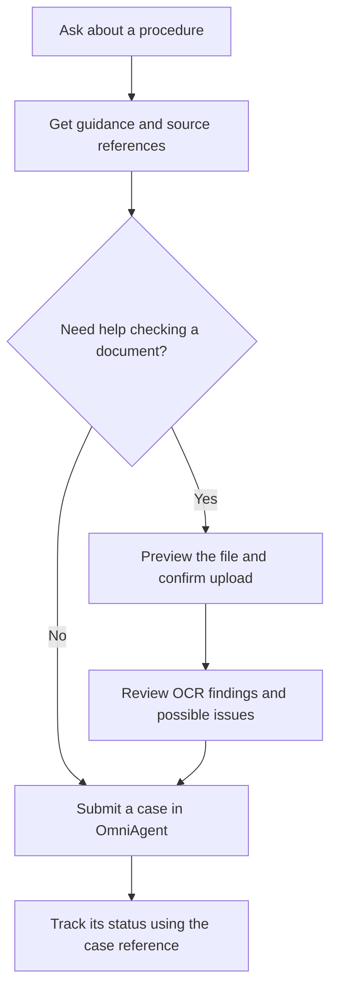
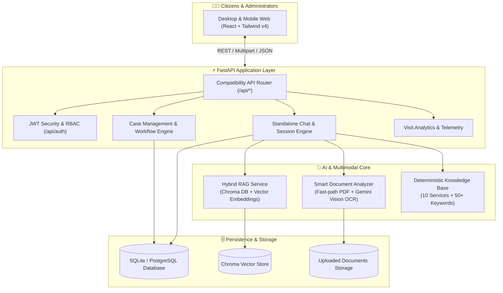
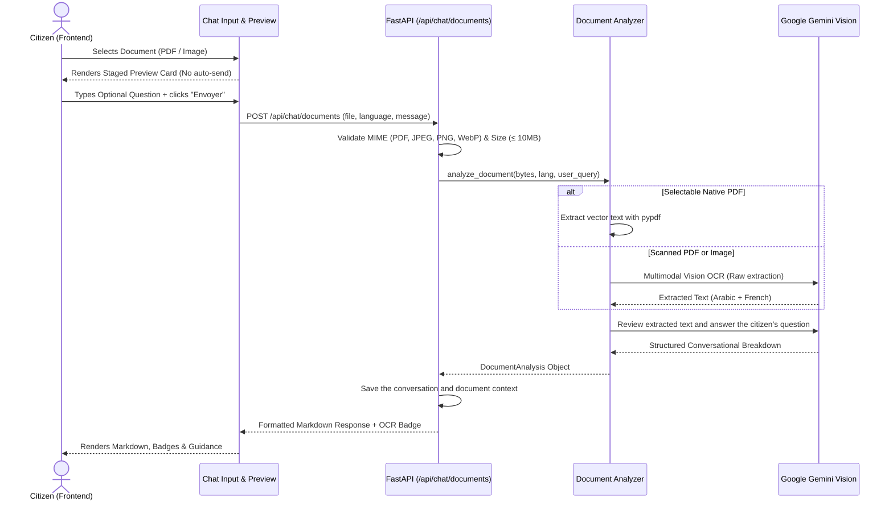
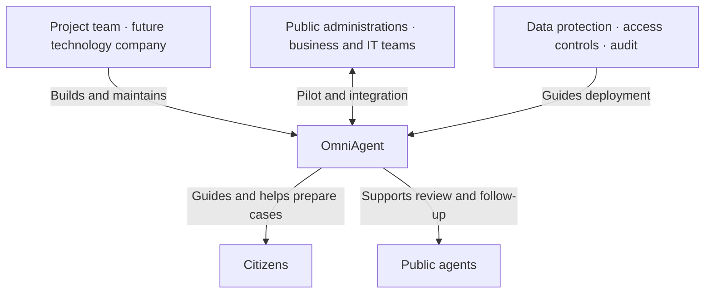

# 🇲🇦 OmniAgent — Moroccan Public Services AI Assistant
### مساعد الخدمات الإدارية العمومية الذكي بالمملكة المغربية

**Find the right administrative procedure, prepare your documents, and track your case in one place.**

OmniAgent is a GovTech prototype built in Tangier for Moroccan public services. Citizens can ask questions in **Darija, Arabic, or French**, review a document before submitting it for analysis, and follow their case. Public agents can review requests and record decisions in a dedicated dashboard.

[Try the demo locally](#-quick-start-guide) · [See how it works](#citizen-journey) · [Explore the architecture](#-system-architecture) · [Meet the team](#-team--responsibilities)

`React` · `FastAPI` · `Gemini Vision` · `ChromaDB` · `Docker`

## Citizen journey

> **Example** · « Quelles pièces dois-je préparer pour demander un certificat de résidence ? »



The case workflow runs inside OmniAgent. The institutional roadmap below covers future integrations with public administrations.

## 📖 Overview

OmniAgent brings together a **catalog of 10 procedures**, **source-grounded chat**, **document pre-checks**, and **case tracking**. Its interface switches between right-to-left and left-to-right layouts.

### 🌐 Languages
OmniAgent natively supports three languages with **RTL / LTR layout switching**:
* **Moroccan Darija (`دارجة مغربية`)** — Everyday Moroccan phrasing for conversational guidance.
* **Modern Standard Arabic (`العربية الفصحى`)** — Official administrative and legal terminology.
* **French (`Français`)** — Standard administrative and technical documentation language.

---

## 🌟 Advanced Features & Capabilities

### 1. 🔬 Document pre-checks and multimodal OCR
An advanced document intelligence engine designed specifically around **Moroccan administrative standards and legal formalities**:

* **Two-Tier Extraction Pipeline**:
  * **Fast-Path Digital PDF Extraction**: Directly parses selectable text from digital PDFs via `pypdf` without calling the OCR API.
  * **Multimodal Vision OCR**: Automatically routes scanned PDFs and mobile camera images (`JPEG`, `PNG`, `WebP`) to **Google Gemini Multimodal Vision API**, to extract Arabic and French text and identify visible elements such as stamps, signatures, and handwritten notes.
* **Moroccan Legal & Administrative Rules Engine**:
  * **Document recency**: Flags potential issues against configured rules, including a three-month threshold where applicable.
  * **Date Anomaly Detector**: Flags expired documents, obsolete fiscal years, or future-dated certificates.
  * **Stamps and signatures**: Flags the apparent presence or absence of visible elements such as stamps, signatures, and QR codes.
  * **Official Language Compliance**: Checks for Arabic/French status and flags when a foreign-language certificate may require a sworn translation (*traduction assermentée près les tribunaux marocains*).
* **Interactive Staged Attachment Workflow (No Auto-Send)**:
  * Uploading a file displays a preview card with file icon, filename, formatted file size, and instant removal (`✕`).
  * Files are **never auto-sent without confirmation**.
* **Co-Prompting & Contextual Questions**:
  * Citizens can attach a document AND type a specific question simultaneously (e.g., *"Est-ce que cette attestation suffit pour renouveler ma CIN ?"*).
  * The AI prioritizes answering the citizen's exact question while delivering the structured document verification.
* **Conversational, Human-Centric Output**:
  * Delivers a concise, natural, and friendly breakdown instead of dense bureaucratic audit reports.
* **Conversational Memory for Follow-ups (Hidden Context RAG)**:
  * Extracted text is stored in conversational memory (`document_context`), allowing citizens to ask follow-up questions about their uploaded files without re-analyzing.
* **Rich Markdown Rendering**:
  * Formatted with custom visual components, headers, bullet points, and dynamic OCR badges (`🔬 Reconnaissance optique de caractères (OCR) utilisée`).

---

### 2. 🏛️ Catalog of 10 Moroccan public services
OmniAgent covers 10 administrative services spanning civil status, family, property, administrative, and justice:

| # | Service (Français) | الخدمة (العربية) | Catégorie | Délai indicatif | Exemples de pièces |
|---|-------------------|-----------------|-----------|-------------|----------------------------|
| 1 | **Certificat de résidence** | شهادة السكنى | État Civil | 2 jours | CIN, Justificatif de domicile (eau/électricité/bail) |
| 2 | **Extrait d'acte de naissance** | رسم الولادة / عقد الازدياد | État Civil | 1 jour | Livret de famille ou CIN des parents |
| 3 | **Contrat de mariage** | عقد الزواج | Famille | 5 jours | Certificat prénuptial, Actes de naissance, CIN |
| 4 | **Certificat de décès** | رسم الوفاة | État Civil | 1 jour | Constat de décès médical, Livret de famille |
| 5 | **Certificat de vie** | شهادة الحياة | État Civil | Immédiat | Présence physique de l'intéressé, CIN |
| 6 | **Certificat de célibat** | شهادة العزوبة | Famille | 2 jours | Extrait de naissance récent, Témoins ou déclaration |
| 7 | **Certificat de non-propriété** | شهادة عدم الملكية | Propriété | 3 jours | Attestation fiscale, Déclaration sur l'honneur |
| 8 | **Certificat administratif** | شهادة إدارية | Administratif | 3 jours | Demande manuscrite, Justificatif du motif |
| 9 | **Certificat de bonne conduite** | شهادة حسن السيرة | Justice | 2 jours | Fiche anthropométrique (DGSN), CIN |
| 10 | **Casier judiciaire** | السجل العدلي | Justice | 2 jours | Fiche de demande, Copie intégrale de naissance, CIN |

Check the relevant administration’s current instructions for exact documents and processing times.

* **Multilingual Routing Dictionary**: Over 50 keyword patterns in Darija, Arabic, and French auto-route queries to their exact administrative domain.

---

### 3. 💬 Multi-Session Chat & Hybrid RAG Pipeline
* **Multi-Session Management**: Create, switch, list, and delete independent conversation threads with automatic title generation.
* **Hybrid Knowledge Retrieval**:
  * Vector similarity search with **Chroma DB** and embeddings.
  * Curated JSON knowledge bases with grounding rules to reduce unsupported answers.
  * Deterministic fallback engine for high availability even when vector stores are offline.
* **Transparent Citations & Confidence Badges**: Displays confidence indicators and source references alongside assistant responses.

---

### 4. 📁 Digital Case Lifecycle & Citizen Portal
* **Automated Case Generation**: Assigns reference tracking codes (`OMN-XXXXX`).
* **Interactive State Machine**: Full lifecycle tracking: `submitted` ➔ `processing` ➔ `approved` / `rejected`.
* **Visual Action Timeline**: Audit trail recording every submission, document upload, status change, and administrative review.
* **In-App Document Viewer**: Secure inline preview and download of attached case documents.

---

### 5. 🛡️ Admin Management & Real-Time Analytics
* **Protected Admin Portal**: JWT authentication and role-based access control (`is_admin`).
* **Case Governance**: Administrative interface to inspect case dossiers, approve/reject requests, and leave official feedback.
* **Platform Analytics Telemetry**: Real-time monitoring of citizen traffic, device distributions, and language preferences.

---

## 🏗️ System Architecture

### High-Level Architecture



### Document OCR pipeline



---

## 🛠️ Tech Stack

### Frontend
* **React 18** with **TypeScript** & **Vite**
* **Tailwind CSS v4** & **Radix UI** primitives
* **React-Markdown** & **Remark-GFM** for rich formatted assistant output
* **TanStack React Query** for asynchronous cache management
* **Lucide React** for icons
* **Wouter** for client-side routing

### Backend
* **FastAPI** — High-performance async Python web framework
* **SQLAlchemy** — ORM for relational models (Cases, Documents, ChatMessages, Users, AuditLogs)
* **Pydantic v2** — Request/response validation
* **python-jose & passlib/bcrypt** — JWT authentication and password hashing
* **pypdf & PyMuPDF (fitz)** — PDF parsing, validation, and rasterization

### AI, Machine Learning & OCR
* **Google Gemini** — Multimodal OCR & document verification
* **LlamaIndex** — Vector index orchestration & RAG retrieval
* **Chroma DB** — Local vector database for semantic document indexing
* **HuggingFace Embeddings** — Multilingual sentence representations

### DevOps & Infrastructure
* **Docker & Docker Compose** — Full stack container orchestration
* **Nginx** — Reverse proxy and static file serving
* **SQLite / PostgreSQL** — Relational database engines

---

## 🚀 Quick Start Guide

### Prerequisites
* **Python 3.10+**
* **Node.js 18+** and **npm**
* *(Optional)* **Docker & Docker Compose**
* *(Recommended)* A **Google Gemini API Key** for Vision OCR ([Get a free key here](https://aistudio.google.com/))

---

### Option A: Local Development Setup

#### 1. Clone the Repository
```bash
git clone https://github.com/chaimaebouassab4-boop/omniagent-public-services-assistant.git
cd omniagent-public-services-assistant
```

#### 2. Configure Backend
```bash
cd backend
python -m venv venv

# Windows (PowerShell)
.\venv\Scripts\Activate.ps1
# Linux / macOS
source venv/bin/activate

pip install -r requirements.txt
```

Create a `.env` file in the `backend/` directory:
```env
DATABASE_URL=sqlite:///./omniagent.db
JWT_SECRET_KEY=your-super-secret-key-change-in-production
ALLOWED_ORIGINS=["http://localhost:3000","http://localhost:5173"]

ADMIN_EMAIL=admin@demo.local
ADMIN_PASSWORD=admin123

# Vision OCR & Multimodal Analysis
GOOGLE_API_KEY=your-gemini-api-key-here
GEMINI_MODEL=your-enabled-gemini-model
```

Set `GEMINI_MODEL` to a model available for your API key, then start the FastAPI backend:
```bash
uvicorn main:app --reload --port 8000
```
API Documentation will be live at: `http://localhost:8000/docs`

#### 3. Configure Frontend
Open a new terminal window:
```bash
cd omniagent
npm install
npm run dev
```
Access the citizen application at: `http://localhost:5173` (or `http://localhost:3000`).

---

### Option B: Docker Deployment

Run the complete stack with a single command:
```bash
docker compose -f docker/docker-compose.yml up --build -d
```

* **Frontend**: `http://localhost:3000`
* **Backend API**: `http://localhost:8000`
* **API Docs**: `http://localhost:8000/docs`

---

## 🔑 Local demo credentials

The example credentials below apply to local development. Set unique credentials and a strong JWT secret for any deployed instance.

| Role | Email | Password | Access |
|------|-------|----------|--------|
| **Administrator** | `admin@demo.local` | `admin123` | Full Admin Dashboard, Case Approvals, Analytics |
| **Citizen (Demo)** | Auto-authenticated (or create account via `/signup`) | - | Chat, Document Upload, Case Tracking |

---

## 🧪 Testing & Quality Assurance

The backend test suite covers:
* Authentication & JWT security
* Citizen case submissions and state machine transitions
* Standalone multi-session chat isolation
* Document upload limits, MIME security, and filename sanitization
* Multimodal chat document OCR integration
* Admin analytics and role-based permissions

Run the test suite from the repository root:
```bash
python -m pytest tests/backend/test_api.py -v
```

```
36 passed, 364 warnings (recorded run)
```

To verify the frontend build:
```bash
cd omniagent
npm run build
```

---

## 👥 Team & Responsibilities

| Contributor | Role | Key Contributions |
|-------------|------|-------------------|
| **👨‍💼 Ayoub El Ouardi** | **Data / AI / Knowledge Engineering** | • Designed & implemented the RAG architecture with Chroma & LlamaIndex<br>• Engineered the Google Gemini Multimodal Vision OCR pipeline<br>• Curated the trilingual Knowledge Base and legal compliance rules<br>• Fine-tuned conversational system prompts for natural citizen interaction<br>• Developed AI evaluation metrics and benchmark datasets |
| **👩‍💻 Chaimae Bouassab** | **Software / Full-Stack Engineering** | • Architected the FastAPI backend REST services and SQLAlchemy models<br>• Developed the interactive React/Tailwind chat UI, RTL support & dashboard<br>• Implemented staged document upload with real-time preview and cancellation<br>• Built the case lifecycle state machine, audit logs, and in-browser previewer<br>• Configured Docker orchestration, JWT auth security, and automated tests |

---

## Governance and deployment

The prototype demonstrates citizen assistance and case management. The following diagram describes the **intended operating model** for an institutional deployment.



| Proposed phase | Purpose | Hosting option |
| --- | --- | --- |
| Public demo | Validate the citizen journey using demonstration data | Vercel with Railway or Render |
| Institutional pilot | Test selected procedures and review outcomes with a partner | National cloud or a controlled environment |
| Production for sensitive use cases | Deploy approved workflows under institutional requirements | On-premises or sovereign infrastructure |

The governance plan includes privacy and administrative simplification considerations (Moroccan laws 09-08 and 55-19), access controls, auditability, and managed integration with institutional systems. Partnerships, hosting choices, and compliance milestones are subject to validation.

**Expected outcomes** include clearer guidance, fewer repeat visits, better-prepared cases, and more accessible services.

## 🗺️ Roadmap

- [x] Full support for 10 Moroccan public services
- [x] Gemini Multimodal Vision OCR with bilingual Arabic/French extraction
- [x] Document pre-checks for recency, visible stamps, and possible translation requirements
- [x] Staged attachment workflow with co-prompting (no auto-upload)
- [x] Multi-session chat with persistent history & topic management
- [ ] Official WhatsApp & Telegram citizen gateways
- [ ] Voice input & speech synthesis for citizens who prefer voice interaction in Moroccan Darija
- [ ] Direct integration with Morocco National Digital ID (CNIE / Portal Idara)
- [ ] End-to-end cloud deployment on Azure / AWS with managed PostgreSQL

---

## 📄 License

This project is licensed under the MIT License. See [LICENSE](LICENSE) for the full text.

---

<div align="center">

Made with ❤️ in **Tangier, Morocco**

**Empowering Moroccan citizens through human-centered, accessible AI** 🚀

</div>
