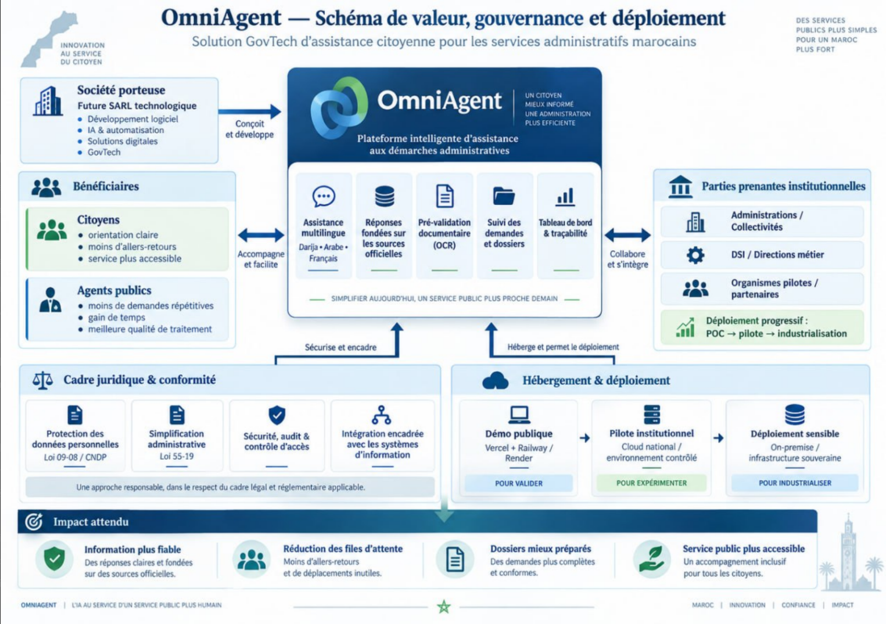
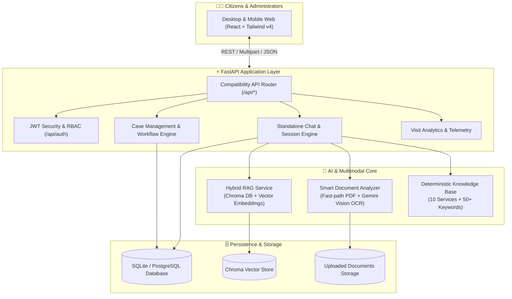
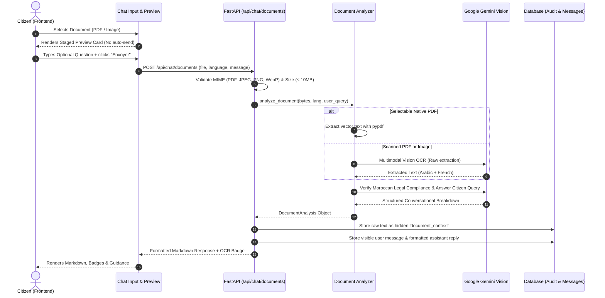

# 🇲🇦 OmniAgent — Moroccan Public Services AI Assistant
### مساعد الخدمات الإدارية العمومية الذكي بالمملكة المغربية

[](#-testing--quality-assurance)
[](https://www.python.org/)
[](https://fastapi.tiangolo.com/)
[](https://react.dev/)
[](https://tailwindcss.com/)
[](https://ai.google.dev/)
[](https://www.docker.com/)

---

## 📖 Overview

**OmniAgent** is an intelligent, trilingual GovTech AI assistant and digital case management platform built specifically for Moroccan public administration. It bridges the gap between citizens and public services by transforming complex administrative regulations into simple, accessible, and conversational guidance.

### Schéma de valeur, gouvernance et déploiement

**OmniAgent — Solution GovTech d’assistance citoyenne pour les services administratifs marocains.** Une plateforme pensée pour accompagner les citoyens en darija, en arabe et en français, faciliter la préparation et le suivi des dossiers, et aider les agents publics à traiter les demandes.

[](docs/diagrams/omniagent-valeur-gouvernance-deploiement.png)

Ce schéma présente la vision du projet : collaboration avec les institutions, protection des données, sécurité et déploiement progressif, de la démonstration publique au pilote institutionnel puis à une infrastructure souveraine. Les partenariats, engagements de conformité et étapes de déploiement présentés constituent des objectifs à valider au fil du projet.

*Simplifier aujourd’hui, un service public plus proche demain.*

### 🌐 True Trilingual Experience
OmniAgent natively understands and responds across three linguistic spectrums with full **RTL / LTR layout switching**:
* **Moroccan Darija (`دارجة مغربية`)** — Conversational, phonetic, and authentic phrasing understood by all citizens.
* **Modern Standard Arabic (`العربية الفصحى`)** — Official administrative and legal terminology.
* **French (`Français`)** — Standard administrative and technical documentation language.

---

## 🌟 Advanced Features & Capabilities

### 1. 🔬 Smart Multimodal Document Analyzer (Vision OCR & Legal Compliance)
An advanced document intelligence engine designed specifically around **Moroccan administrative standards and legal formalities**:

* **Two-Tier Extraction Pipeline**:
  * **Fast-Path Digital PDF Extraction**: Directly parses selectable text from digital PDFs via `pypdf` with zero external API latency.
  * **Multimodal Vision OCR**: Automatically routes scanned PDFs and mobile camera images (`JPEG`, `PNG`, `WebP`) to **Google Gemini Multimodal Vision API**, accurately extracting bilingual Arabic and French text, seals, signatures, and handwritten notes.
* **Moroccan Legal & Administrative Rules Engine**:
  * **3-Month Legal Validity Rule**: Validates whether the document respects the Moroccan administrative 3-month recency requirement.
  * **Date Anomaly Detector**: Flags expired documents, obsolete fiscal years, or future-dated certificates.
  * **Stamp & Signature Verification**: Checks for official wet stamps (*cachet humide*), signers, delegating authorities, and QR verification codes.
  * **Official Language Compliance**: Checks for Arabic/French status and alerts citizens if an English or foreign certificate requires a certified sworn translation (*traduction assermentée près les tribunaux marocains*).
* **Interactive Staged Attachment Workflow (No Auto-Send)**:
  * Uploading a file displays a preview card with file icon, filename, formatted file size, and instant removal (`✕`).
  * Files are **never auto-sent without confirmation**.
* **Co-Prompting & Contextual Questions**:
  * Citizens can attach a document AND type a specific question simultaneously (e.g., *"Est-ce que cette attestation suffit pour renouveler ma CIN ?"*).
  * The AI prioritizes answering the citizen's exact question while delivering the structured document verification.
* **Conversational, Human-Centric Output**:
  * Delivers a concise, natural, and friendly breakdown instead of dense bureaucratic audit reports.
* **Conversational Memory for Follow-ups (Hidden Context RAG)**:
  * Extracted text is stored in conversational memory (`document_context`), allowing citizens to ask follow-up questions about their uploaded files without re-analyzing.
* **Rich Markdown Rendering**:
  * Formatted with custom visual components, headers, bullet points, and dynamic OCR badges (`🔬 Reconnaissance optique de caractères (OCR) utilisée`).

---

### 2. 🏛️ Full Catalog of 10 Moroccan Public Services
OmniAgent covers 10 administrative services spanning civil status, family, property, administrative, and justice:

| # | Service (Français) | الخدمة (العربية) | Catégorie | Délai moyen | Documents requis essentiels |
|---|-------------------|-----------------|-----------|-------------|----------------------------|
| 1 | **Certificat de résidence** | شهادة السكنى | État Civil | 2 jours | CIN, Justificatif de domicile (eau/électricité/bail) |
| 2 | **Extrait d'acte de naissance** | رسم الولادة / عقد الازدياد | État Civil | 1 jour | Livret de famille ou CIN des parents |
| 3 | **Contrat de mariage** | عقد الزواج | Famille | 5 jours | Certificat prénuptial, Actes de naissance, CIN |
| 4 | **Certificat de décès** | رسم الوفاة | État Civil | 1 jour | Constat de décès médical, Livret de famille |
| 5 | **Certificat de vie** | شهادة الحياة | État Civil | Immédiat | Présence physique de l'intéressé, CIN |
| 6 | **Certificat de célibat** | شهادة العزوبة | Famille | 2 jours | Extrait de naissance récent, Témoins ou déclaration |
| 7 | **Certificat de non-propriété** | شهادة عدم الملكية | Propriété | 3 jours | Attestation fiscale, Déclaration sur l'honneur |
| 8 | **Certificat administratif** | شهادة إدارية | Administratif | 3 jours | Demande manuscrite, Justificatif du motif |
| 9 | **Certificat de bonne conduite** | شهادة حسن السيرة | Justice | 2 jours | Fiche anthropométrique (DGSN), CIN |
| 10 | **Casier judiciaire** | السجل العدلي | Justice | 2 jours | Fiche de demande, Copie intégrale de naissance, CIN |

* **Multilingual Routing Dictionary**: Over 50+ keyword patterns in Darija, Arabic, and French auto-route queries to their exact administrative domain.

---

### 3. 💬 Multi-Session Chat & Hybrid RAG Pipeline
* **Multi-Session Management**: Create, switch, list, and delete independent conversation threads with automatic title generation.
* **Hybrid Knowledge Retrieval**:
  * Vector similarity search with **Chroma DB** and embeddings.
  * Curated JSON knowledge bases with grounding rules to eliminate hallucinations.
  * Deterministic fallback engine for high availability even when vector stores are offline.
* **Transparent Citations & Confidence Badges**: Displays confidence scores (e.g., `Confiance: 95%`) and source citations on assistant responses.

---

### 4. 📁 Digital Case Lifecycle & Citizen Portal
* **Automated Case Generation**: Assigns reference tracking codes (`OMN-XXXXX`).
* **Interactive State Machine**: Full lifecycle tracking: `submitted` ➔ `processing` ➔ `approved` / `rejected`.
* **Visual Action Timeline**: Immutable audit trail logging every submission, document upload, status change, and administrative review.
* **In-App Document Viewer**: Secure inline preview and download of attached case documents.

---

### 5. 🛡️ Admin Management & Real-Time Analytics
* **Protected Admin Portal**: JWT authentication and role-based access control (`is_admin`).
* **Case Governance**: Administrative interface to inspect case dossiers, approve/reject requests, and leave official feedback.
* **Platform Analytics Telemetry**: Real-time monitoring of citizen traffic, device distributions, and language preferences.

---

## 🏗️ System Architecture

### High-Level Architecture



### Document OCR & Compliance Pipeline



---

## 🛠️ Tech Stack

### Frontend
* **React 18** with **TypeScript** & **Vite**
* **Tailwind CSS v4** & **Radix UI** primitives
* **React-Markdown** & **Remark-GFM** for rich formatted assistant output
* **TanStack React Query** for asynchronous cache management
* **Lucide React** for icons
* **Wouter** for client-side routing

### Backend
* **FastAPI** — High-performance async Python web framework
* **SQLAlchemy** — ORM for relational models (Cases, Documents, ChatMessages, Users, AuditLogs)
* **Pydantic v2** — Request/response validation
* **python-jose & passlib/bcrypt** — JWT authentication and password hashing
* **pypdf & PyMuPDF (fitz)** — PDF parsing, validation, and rasterization

### AI, Machine Learning & OCR
* **Google Generative AI (Gemini 1.5/2.0 Flash)** — Multimodal OCR & document verification
* **LlamaIndex** — Vector index orchestration & RAG retrieval
* **Chroma DB** — Local vector database for semantic document indexing
* **HuggingFace Embeddings** — Multilingual sentence representations

### DevOps & Infrastructure
* **Docker & Docker Compose** — Full stack container orchestration
* **Nginx** — Reverse proxy and static file serving
* **SQLite / PostgreSQL** — Relational database engines

---

## 🚀 Quick Start Guide

### Prerequisites
* **Python 3.10+**
* **Node.js 18+** and **npm**
* *(Optional)* **Docker & Docker Compose**
* *(Recommended)* A **Google Gemini API Key** for Vision OCR ([Get a free key here](https://aistudio.google.com/))

---

### Option A: Local Development Setup

#### 1. Clone the Repository
```bash
git clone https://github.com/chaimaebouassab4-boop/omniagent-public-services-assistant.git
cd omniagent-public-services-assistant
```

#### 2. Configure Backend
```bash
cd backend
python -m venv venv

# Windows (PowerShell)
.\venv\Scripts\Activate.ps1
# Linux / macOS
source venv/bin/activate

pip install -r requirements.txt
```

Create a `.env` file in the `backend/` directory:
```env
DATABASE_URL=sqlite:///./omniagent.db
JWT_SECRET_KEY=your-super-secret-key-change-in-production
ALLOWED_ORIGINS=["http://localhost:3000","http://localhost:5173"]

ADMIN_EMAIL=admin@demo.local
ADMIN_PASSWORD=admin123

# Vision OCR & Multimodal Analysis
GOOGLE_API_KEY=your-gemini-api-key-here
GEMINI_MODEL=gemini-1.5-flash
```

Start the FastAPI backend:
```bash
uvicorn main:app --reload --port 8000
```
API Documentation will be live at: `http://localhost:8000/docs`

#### 3. Configure Frontend
Open a new terminal window:
```bash
cd omniagent
npm install
npm run dev
```
Access the citizen application at: `http://localhost:5173` (or `http://localhost:3000`).

---

### Option B: Docker Deployment

Run the complete stack with a single command:
```bash
docker compose -f docker/docker-compose.yml up --build -d
```

* **Frontend**: `http://localhost:3000`
* **Backend API**: `http://localhost:8000`
* **API Docs**: `http://localhost:8000/docs`

---

## 🔑 Default Credentials

| Role | Email | Password | Access |
|------|-------|----------|--------|
| **Administrator** | `admin@demo.local` | `admin123` | Full Admin Dashboard, Case Approvals, Analytics |
| **Citizen (Demo)** | Auto-authenticated (or create account via `/signup`) | - | Chat, Document Upload, Case Tracking |

---

## 🧪 Testing & Quality Assurance

The backend features an automated test suite verifying all critical API surfaces:
* Authentication & JWT security
* Citizen case submissions and state machine transitions
* Standalone multi-session chat isolation
* Document upload limits, MIME security, and filename sanitization
* Multimodal chat document OCR integration
* Admin analytics and role-based permissions

Run the test suite:
```bash
python -m pytest tests/backend/test_api.py -v
```

```
====================== 36 passed, 364 warnings in 3.19s =======================
```

To verify the frontend build:
```bash
cd omniagent
npm run build
```

---

## 👥 Team & Responsibilities

| Contributor | Role | Key Contributions |
|-------------|------|-------------------|
| **👨‍💼 Ayoub** | **Data / AI / Knowledge Engineering** | • Designed & implemented the RAG architecture with Chroma & LlamaIndex<br>• Engineered the Google Gemini Multimodal Vision OCR pipeline<br>• Curated the trilingual Knowledge Base and legal compliance rules<br>• Fine-tuned conversational system prompts for natural citizen interaction<br>• Developed AI evaluation metrics and benchmark datasets |
| **👩‍💻 Chaimae** | **Software / Full-Stack Engineering** | • Architected the FastAPI backend REST services and SQLAlchemy models<br>• Developed the interactive React/Tailwind chat UI, RTL support & dashboard<br>• Implemented staged document upload with real-time preview and cancellation<br>• Built the case lifecycle state machine, audit logs, and in-browser previewer<br>• Configured Docker orchestration, JWT auth security, and automated tests |

---

## 🗺️ Roadmap

- [x] Full support for 10 Moroccan public services
- [x] Gemini Multimodal Vision OCR with bilingual Arabic/French extraction
- [x] Moroccan legal compliance verification (3-month rule, stamps, sworn translations)
- [x] Staged attachment workflow with co-prompting (no auto-upload)
- [x] Multi-session chat with persistent history & topic management
- [ ] Official WhatsApp & Telegram citizen gateways
- [ ] Voice input & speech synthesis for illiterate citizens in Moroccan Darija
- [ ] Direct integration with Morocco National Digital ID (CNIE / Portal Idara)
- [ ] End-to-end cloud deployment on Azure / AWS with managed PostgreSQL

---

<div align="center">

Made with ❤️ in **Tangier, Morocco**

**Empowering Moroccan citizens through human-centered, accessible AI** 🚀

</div>
